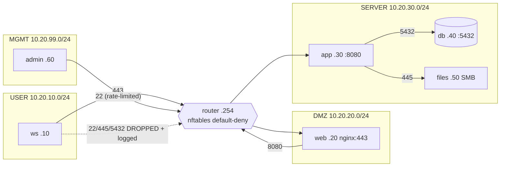

# PS-2 Flatland — network segmentation & firewall design

## Quick start (WSL2 Ubuntu, Docker Desktop running)
```bash
./run.sh flat up          # build + start flat lab
./run.sh flat business    # 10/10 PASS  (portal works)
./run.sh flat integrity   # DATA INTACT
./run.sh flat attack      # 5/5 SUCCEEDED, ends with "DATA TAMPERED" (salary of id 3 -> 999999)
./run.sh flat down

./run.sh seg up           # 4 zones + router with default-deny nftables (fresh, clean data)
./run.sh seg business     # 10/10 PASS
./run.sh seg attack       # 0/5, ends with "DATA INTACT"
./run.sh seg fw           # firewall counters + dropped-packet log
./run.sh seg down
```
Employee Portal in your Windows browser: **https://localhost:8443** (accept the self-signed certificate warning).
Refresh it after the flat attack to show the changed salary. `./run.sh <mode> reset` restores clean data.
Every run is saved with a timestamp in `evidence/`.

## Web dashboard (recommended for the demo)
```bash
python3 dashboard/server.py        # then open http://localhost:8000 in your Windows browser
```
- Toggle **BEFORE (flat)** / **AFTER (segmented)**, then press **Start lab** and **Run full demo** (business test, attack, firewall log).
- Live network map: attack paths turn amber while running, red when they succeed, and stop at the router ✕ when blocked.
- Attack chain A1–A5 with ATT&CK IDs, 10 business flows, payroll table (tampered salary shown as 72000 → 999999), firewall drops and counters, live terminal.
- The Before/After comparison table fills in as you run both modes. Starting one lab stops the other (both use port 8443).
- Listens on 127.0.0.1 only and can only run the `./run.sh` commands. Standard-library Python, no installs.

## Files
| File | Purpose |
|---|---|
| `dashboard/` | Web dashboard: `server.py` (backend) + `index.html` (UI) |
| `docker-compose.flat.yml` | BEFORE: 6 hosts on 10.10.0.0/24 |
| `docker-compose.seg.yml` | AFTER: 4 zones + `router` container (ip_forward, nftables) |
| `lab/conf/router.nft` | **Ruleset deliverable**: default-deny, NFLOG-logged drops, SSH rate limit, egress filter |
| `lab/conf/db-host.nft` | Stretch: micro-segmentation on db |
| `lab/attack.sh` | Attack script (runs inside ws = compromised employee PC): scan, SSH→db, SMB→files, scp→app, change a db row |
| `lab/integrity.sh` | Compares the employees table with `lab/conf/employees.baseline` → DATA INTACT / DATA TAMPERED |
| `lab/app.py` | Employee Portal (app server), served through nginx on web:443 |
| `lab/conf/init.sql` | Creates and seeds the `employees` table |
| `lab/business.sh` | Business test: 9 legitimate flows, each run from its real source host |
| `lab/entry.sh`, `lab/db-entry.sh` | Container start-up (services + default route via router) |
| `image/`, `db-image/` | Debian 12 image with all tools; Postgres 16 + sshd |

Credentials (lab only): user `it` / `Summer2024` on every host (reused-password scenario); DB `appuser` / `AppDb2024`.

## Addressing plan / security zones
| Zone | Subnet | Hosts | Trust |
|---|---|---|---|
| USER | 10.20.10.0/24 | ws .10 | low (assume compromised) |
| DMZ | 10.20.20.0/24 | web .20 (nginx, TLS 443) | public-facing |
| SERVER | 10.20.30.0/24 | app .30 (8080), db .40 (5432), files .50 (SMB 445) | high |
| MGMT | 10.20.99.0/24 | admin .60 (jump host) | privileged |
| — | .254 in each | router (nftables) | enforcement point |

Flat (before): ws .10, web .20, app .30, db .40, files .50, admin .60 all on 10.10.0.0/24.

## Data-flow table (flow matrix)
| # | Source | Destination | Port | Why | Router rule |
|---|---|---|---|---|---|
| B1 | USER (ws) | web | 443/tcp | users browse the company site | F1 |
| B2 | ws→web→app→db | — | 443→8080→5432 | employees use the Employee Portal | F1+F2 (+ intra-zone) |
| B3 | web | app | 8080/tcp | reverse proxy to the API | F2 |
| B4 | app | db | 5432/tcp | app queries DB | intra-SERVER (micro-seg allows) |
| B5 | app | files | 445/tcp | app writes reports | intra-SERVER |
| B6 | admin | all hosts | 22/tcp | management | F3 (rate-limited 10/min) |
| — | anything else | anything | any | — | **DROP + log** |

## Network diagram (paste into draw.io or mermaid.live)


## ATT&CK mapping
| Attack stage | Technique | Before | After | D3FEND / mitigation |
|---|---|---|---|---|
| A1 nmap scan of internal hosts | T1046 Network Service Discovery, T1018 Remote System Discovery | succeeds | only web:443 visible | Network Isolation; M1030 Network Segmentation |
| A2 SSH ws→db | T1021.004 Remote Services: SSH | succeeds | blocked | Inbound Traffic Filtering; M1037 Filter Network Traffic |
| A3 SMB ws→files | T1021.002 SMB/Windows Admin Shares | succeeds | blocked | Inbound Traffic Filtering; M1037 |
| A4 scp tool ws→app | T1570 Lateral Tool Transfer | succeeds | blocked | Network Isolation; M1030 |
| A5 change employee salary in db | T1565.001 Stored Data Manipulation (Impact) | succeeds → DATA TAMPERED | blocked → DATA INTACT | M1030, M1037; micro-seg on db |
| Stretch: egress drop | blocks C2 callbacks | — | server zone cannot initiate out | Outbound Traffic Filtering |

## Demo script (5-7 min)
1. (30 s) Story: "Corp runs everything on one flat network. An employee PC (ws) is compromised."
2. (60 s) Flat lab: open https://localhost:8443 → Employee Portal, Meera Iyer salary 72000. `./run.sh flat business` → 10/10.
3. (90 s) `./run.sh flat attack` → 5/5 SUCCEEDED, "DATA TAMPERED". Refresh the portal → salary 999999.
4. (90 s) Fix: zones diagram + flow matrix + walk through `router.nft` (default deny, explicit allows, logging).
5. (90 s) `./run.sh seg attack` → 0/5, "DATA INTACT"; portal unchanged; `./run.sh seg business` → 10/10.
6. (60 s) `./run.sh seg fw` → FWD-DROP lines for ws→db:5432 / :22 / files:445; mention stretch (micro-seg, egress, SSH rate limit).
Judges may try their own command, e.g. `docker compose -p seg -f docker-compose.seg.yml exec ws nmap -Pn -p- db`.

## Troubleshooting
- Portal doesn't open in seg mode in the browser: show it from the workstation instead: `docker compose -p seg -f docker-compose.seg.yml exec ws curl -sk https://web/`.
- Seed data only loads on a fresh db: use `./run.sh <mode> reset` (or down + up).
- Subnet clash on `up`: change 10.10/10.20 ranges in compose and `router.nft` together.
- `WARN: ... retrying without NFLOG`: the kernel lacks NFLOG; the drops are still enforced, so show the counters (`nft list ruleset`) as evidence.
- Don't set `internal: true` on the seg networks: Docker then drops routed traffic.
- Changing scripts/configs in `lab/` needs no rebuild (mounted); for nft changes: `docker compose -p seg -f docker-compose.seg.yml restart router`.
